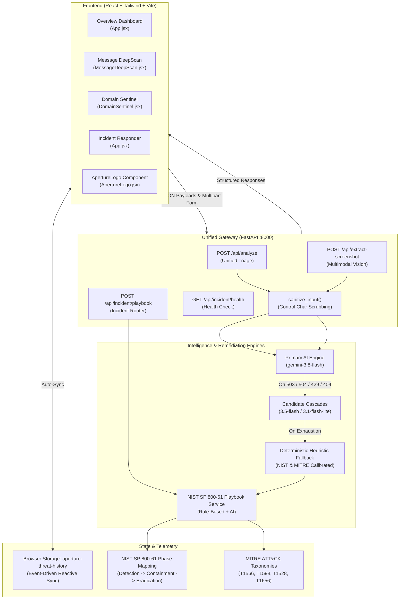

# APERTURE (`APERTURE.AI`) — Threat Intelligence & Dynamic Incident Remediation

> **Enterprise Cybersecurity Architecture & Development Reference**  
> **Engineering Team:** Aditya Tiwari, Aditya Raj, Aditya Rawat  
> **Core Framework Standards:** NIST SP 800-61 Rev. 2 · MITRE ATT&CK Enterprise Taxonomies  
> **Status:** Fully Operational & Verified (30/30 Integration Tests Passing)

---

## 1. Executive Summary & Project Identity

### 1.1 Etymology & Mission
Derived from the optical concept—an opening through which light and detail pass—**APERTURE** operates as an autonomous, high-precision digital lens that exposes hidden attack vectors, social engineering cues, and obfuscated domain signals that routinely bypass static secure email gateways (SEGs) and average human scrutiny.

### 1.2 Core Differentiation
Traditional cyber filters rely on brittle blacklists, keyword counts (TF-IDF), or rigid regex matches. They fail against modern conversational spear-phishing, brand homoglyph spoofing, and zero-day social engineering. Furthermore, traditional scanners merely alert without offering operational containment.

**APERTURE bridges this gap with:**
1. **Single-Pass Multi-Vector AI Reasoning:** Leverages Google Gemini's latest frontier flash models (`gemini-3.8-flash`, with seamless candidate cascading to `gemini-3.5-flash` and `gemini-3.1-flash-lite`), evaluating Sender, Content, and URL vectors concurrently in structured JSON schemas.
2. **Deterministic Heuristic Safeguards:** Guarantees zero 500 errors through an autonomous fallback engine calibrated against real-world threat weights (NIST & MITRE aligned).
3. **Multimodal Vision Ingestion:** Native computer vision parsing of email/SMS screenshots directly into structured fields without brittle external OCR libraries (Tesseract/PaddleOCR).
4. **Active Incident Remediation:** Converts triage output into Tier-3 SOC Incident Playbooks featuring immediate containment commands, technical IoCs, and formatted Markdown escalation briefings.

---

## 2. Chronological Development Journey & Evolution

### Stage 0: Legacy Codebase Audit & Fracture Resolution
- **Starting Point:** The repository contained legacy traces of "TrustLens AI", fractured across a stub directory `backend-1` and a separate `backend-2` implementation.
- **Action Taken:**
  - Consolidated backend into a single canonical directory: `backend/`.
  - Deprecated and safely removed obsolete `backend-1` and `backend-2` fragments.
  - Standardized all relative paths, environment configurations, and documentation.

### Stage 1: Request Schema & Data Contract Standardization
- **Challenge:** Frontend and backend expected disparate payload keys, causing silent rendering failures and undefined states.
- **Resolution:** Defined strict Pydantic v2 data contracts in [`backend/schemas.py`](backend/schemas.py):
  - `AnalyzePayload`: Ingress payload supporting both `"message"` and `"url"` triage modes.
  - `SenderCheck`: Display name spoofing, webmail provider verification, and reputation diagnostics.
  - `ContentCheck`: Psychological extortion detection, urgency tactics, and sentiment analysis.
  - `URLCheck`: Extracted URLs, typosquatting/homoglyph flags, redirects, and domain risk summaries.
  - `IncidentPlaybook`: NIST SP 800-61 lifecycle steps, MITRE ATT&CK mapping, and Markdown escalation briefings.
  - `ScreenshotExtractionResponse`: Structured vision fields (`sender`, `message`, `detected_urls`, `missing_critical_info`).

### Stage 2: Feature 1 Multi-Vector Triage & Deterministic Fallback
- Built [`backend/feature1_service.py`](backend/feature1_service.py) featuring:
  - **Single-Pass Inference Prompt:** Constrains the LLM to simultaneously evaluate all vectors, assign dynamic risk weights ($0 - 100$), classify one of 5 threat archetypes, and compose a Tier-3 escalation briefing.
  - **Deterministic Rule-Based Fallback:** High-fidelity heuristic engine parsing email headers, deceptive subdomains, suspicious TLDs, and behavioral urgency cues.

### Stage 3: Decoupled Specialized Frontend Modules
- Decomposed the legacy monolithic analyzer into dedicated, specialized operational views:
  - **[MessageDeepScan.jsx](frontend/react-app/src/MessageDeepScan.jsx):** Ingress message analysis with drag-and-drop screenshot vision upload, telemetry alerts for cropped headers, and one-click SOC briefing copy with 2-second visual feedback.
  - **[DomainSentinel.jsx](frontend/react-app/src/DomainSentinel.jsx):** Dedicated URL/hostname dissection module analyzing Shannon entropy, Punycode, homoglyph substitutions, and generating DNS sinkhole mitigation commands.
  - **[App.jsx](frontend/react-app/src/App.jsx):** Executive SOC Overview dashboard, chronological audit trail, and Incident Responder deck.

### Stage 4: Multimodal Vision Ingestion (Zero External OCR)
- Replaced traditional OCR pipelines with native multimodal vision using `gemini-3.8-flash`.
- Raw image bytes (`image/png`, `image/jpeg`, `image/webp`) are passed directly via `types.Part.from_bytes()` into Gemini's visual reasoning engine, auto-populating form inputs and flagging cropped headers.

### Stage 5: Rebranding & Storage Migration
- Purged all references to `TrustLens`, `Demo Mode` badges, and legacy development disclaimers.
- Migrated browser storage from `trust-lens-history` to `aperture-threat-history`, with an automatic non-destructive migration bridge for existing records.

### Stage 6: UI Polish & Official Brand Identity
- Integrated the official **APERTURE** shield iris logo emblem into [`frontend/react-app/src/ApertureLogo.jsx`](frontend/react-app/src/ApertureLogo.jsx).
- Upgraded the audit timeline cards with dynamic, severity-glowing badges (`rose` for Phishing, `amber` for Suspicious, `emerald` for Safe) and contextual archetype Lucide icons (`KeyRound`, `Globe`, `Banknote`, `Bug`, `ShieldCheck`).

---

## 3. Critical Bugs Encountered & Technical Resolutions

| # | Issue Encountered | Root Cause | Architectural Fix Applied |
|---|---|---|---|
| **1** | `404 NOT_FOUND` on `models/gemini-2.5-flash` | Google retired new API access for the `gemini-2.5-flash` endpoint, requiring `gemini-3.8-flash`. | Updated primary model to `gemini-3.8-flash` and built a dynamic candidate fallback cascade (`gemini-3.8-flash` $\rightarrow$ `gemini-3.5-flash` $\rightarrow$ `gemini-3.1-flash-lite`). |
| **2** | `503 UNAVAILABLE` & `504 DEADLINE_EXCEEDED` on Free Tier | Temporary traffic spikes on Google AI Studio caused request timeouts and capacity exceptions. | Implemented `http_options={"api_version": "v1beta", "timeout": 20000}` (20s timeout window) and added auto-cascade on `503`, `504`, `429`, and `UNAVAILABLE`. If all models are congested, the deterministic heuristic engine steps in immediately. |
| **3** | WindowsApps Execution Alias Permissions in Sandbox | `python.exe` invoked inside Windows PowerShell sandboxes triggered `ResourceUnavailable: The file cannot be accessed by the system` due to AppContainer reparse points. | Resolved direct executable target under `C:\Users\adity\AppData\Local\Microsoft\WindowsApps\PythonSoftwareFoundation.Python.3.11_qbz5n2kfra8p0\python.exe`. |
| **4** | False Negatives on Combosquatting Domains | Domains like `login-microsoft-auth.com` or `paypa1.com` without explicit display names evaded simple homoglyph checks. | Added deep brand regex and combosquatting detection across sender domain, display name, and URL hostnames (+35 pts weight). |
| **5** | Windows PowerShell Execution Policy (`npm.ps1`) | `npm run build` failed when PowerShell blocked unsigned `.ps1` execution scripts. | Standardized scripts on `npm.cmd` (`npm.cmd run dev`, `npm.cmd run build`). |
| **6** | Line Ending Mismatches (`CRLF` vs `LF`) | Precise text search replacements failed on Windows due to carriage return formatting. | Standardized file writes with unified line endings. |

---

## 4. Final System Architecture



---

## 5. Threat Scoring & Framework Alignment

### 5.1 Calibrated Threat Weights ($0 - 100$)
- **Direct Sender Impersonation / Webmail claiming Enterprise:** $+30 \text{ to } +35\text{ pts}$
- **Brand Combosquatting / Deceptive Subdomain Stacking:** $+35\text{ pts}$
- **Homoglyphs / Punycode (e.g., `paypa1.com`):** $+35\text{ pts}$
- **High-Urgency Behavioral Extortion (Account Lockout, Legal Action):** $+20 \text{ to } +25\text{ pts}$
- **Credential Harvesting Intent (Password/SSO Portal Prompt):** $+30\text{ pts}$
- **Financial Fraud / Wire Alteration Intent:** $+25 \text{ to } +35\text{ pts}$
- **Malware Dropper / Suspicious Payload Links:** $+35 \text{ to } +45\text{ pts}$

### 5.2 Verdict & Severity Thresholds
- $\text{Threat Score} \ge 70 \implies \textbf{PHISHING} \quad (\text{CRITICAL if } \ge 90, \text{ else HIGH})$
- $\text{Threat Score } 40 - 69 \implies \textbf{SUSPICIOUS} \quad (\text{MEDIUM})$
- $\text{Threat Score } < 40 \implies \textbf{SAFE} \quad (\text{LOW})$

### 5.3 MITRE ATT&CK Mapping
- `T1566.002`: Spearphishing Link
- `T1566.001`: Spearphishing Attachment
- `T1528`: Steal Application Access Token
- `T1656`: Impersonation (Sender & Display Name Spoofing)
- `T1598`: Phishing for Information

---

## 6. Directory Layout & File Responsibilities

```
d:/projects/mpia/codebase/
├── .gitignore                                 # Protects .env, __pycache__, node_modules
├── README.md                                  # Complete System & Architectural Reference
│
├── backend/                                   # Unified FastAPI Gateway
│   ├── .env                                   # Secret GEMINI_API_KEY & Model Config
│   ├── .env.example                           # Standard configuration template
│   ├── requirement.txt                        # Python dependencies
│   ├── schemas.py                             # Canonical Pydantic v2 data contracts
│   ├── feature1_service.py                    # Multi-vector triage, fallback, screenshot vision
│   ├── playbook_service.py                    # NIST SP 800-61 Tier-3 playbook generator
│   ├── incident_router.py                     # Feature 2 Incident Router mount
│   ├── main.py                                # API Gateway, CORS, input sanitization
│   └── test_aperture_system.py                # 30/30 Automated verification test suite
│
└── frontend/react-app/                        # Modern SOC React Dashboard
    ├── public/
    │   ├── aperture-shield.png                # Official glowing shield emblem logo
    │   └── aperture-wordmark.png              # Official wordmark branding
    ├── src/
    │   ├── ApertureLogo.jsx                   # Reusable emblem component with SVG fallback
    │   ├── App.jsx                            # Overview dashboard & Incident Responder deck
    │   ├── MessageDeepScan.jsx                # Message triage & screenshot upload module
    │   ├── DomainSentinel.jsx                 # URL & typosquatting dissection module
    │   ├── ThreatAnalyzer.jsx                 # Module export adapter
    │   └── main.jsx                           # React root
    └── package.json                           # Dependencies & scripts (Vite, Tailwind, Lucide)
```

---

## 7. Operational Instructions

### 7.1 Starting the APERTURE Backend
```powershell
cd d:\projects\mpia\codebase\backend
python -m uvicorn main:app --reload --port 8000
```
- **API Documentation (Swagger):** `http://localhost:8000/docs`
- **Root Health Status:** `http://localhost:8000/`

### 7.2 Starting the React Dashboard
```powershell
cd d:\projects\mpia\codebase\frontend\react-app
npm.cmd run dev
```
- **Dashboard URL:** `http://localhost:5173`

### 7.3 Executing the Complete Regression Suite
```powershell
cd d:\projects\mpia\codebase\backend
python test_aperture_system.py
```
*Executes all 30 automated integration tests covering schemas, heuristic fallbacks, candidate cascades, vision parsing, and live endpoint routing.*
